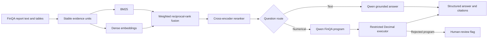

# Financial Report RAG with Hybrid Retrieval and Safe Numerical Reasoning

A reproducible proof of concept for answering text- and table-based questions over financial reports. The system combines BM25, dense retrieval, reciprocal-rank fusion, cross-encoder reranking, local Qwen generation, a restricted numerical executor, verifiable citations, and a FastAPI service.

The project uses the public [FinQA dataset](https://github.com/czyssrs/FinQA) at pinned revision `0f16e2867befa6840783e58be38c9efb9229d742`. Raw data and model weights are downloaded at runtime and are not redistributed.

## Verified outcomes

- On 1,147 held-out FinQA test queries, Recall@5 increased from **72.09% with BM25 to 81.46% with hybrid retrieval and reranking** (+9.37 percentage points); MRR@5 increased from 0.622 to 0.746.
- In a controlled 100-query arithmetic-stage experiment, direct `Qwen/Qwen3-4B-Instruct-2507` calculation achieved 48% exact match, while the restricted Python executor achieved 100%, reducing arithmetic error rate from 52% to 0%.
- The safe executor reproduced **8,281/8,281** public FinQA gold programs across train, development, and test splits without using `eval` or executing model-generated Python.
- Two independent locked runs produced identical rankings, model outputs, parsed answers, and correctness results. Latency was excluded from equality checks because wall-clock timing naturally varies.
- A real FastAPI smoke request retrieved the correct evidence, generated `divide(39, 4)`, and returned `9.75` with five source citations.

The numerical result is intentionally scoped: both conditions receive the same gold evidence and gold symbolic program, so it isolates arithmetic execution. It is **not** a claim of 100% end-to-end question answering or program-generation accuracy.

## Architecture



BM25 rewards exact financial terms and year/metric matches. Dense retrieval captures semantic paraphrases. Reciprocal-rank fusion combines their ranks without assuming comparable score scales, and a cross-encoder then evaluates each query–evidence pair more precisely over a small candidate set.

## Experiment design and leakage control

- The development split alone selected `candidate_k ∈ {10, 20}` and BM25 fusion weight `∈ {0.5, 1.0, 2.0}`.
- The selected configuration was frozen at `candidate_k=10`, BM25 weight `0.5`, dense weight `1.0`, and `rrf_k=60` before test evaluation.
- The public test split was evaluated twice with the same configuration; it was not used to tune retrievers, weights, or prompts.
- The numerical sample contains the first 100 eligible test IDs after sorting by SHA-256 of `"42:" + example_id`. The ordered IDs are committed in the numerical manifest.
- Direct Qwen and Python execution receive the same question, gold evidence, and gold FinQA program. This removes retrieval and program-prediction errors from the arithmetic comparison.
- Prediction rows, manifests, configuration files, deterministic hashes, and a metric-recomputation command are committed.

## Results

### Locked retrieval test

| Method | Recall@5 | Hit@5 | MRR@5 | NDCG@5 | P95 latency |
|---|---:|---:|---:|---:|---:|
| BM25 | 72.09% | 84.74% | 0.622 | 0.605 | 0.36 ms |
| Dense | 78.43% | 90.06% | 0.724 | 0.696 | 6.16 ms |
| Hybrid | 78.87% | 90.76% | 0.727 | 0.699 | 6.21 ms |
| Hybrid + reranker | **81.46%** | **93.03%** | **0.746** | **0.720** | 15.18 ms |

All retrieval methods use the same 1,147 queries and report-local evidence corpus. Latency was measured on an NVIDIA GeForce RTX 5060 Ti; it excludes one-time model download and load time.

### Controlled numerical execution

| Condition | Exact match | Arithmetic errors | Error rate | P50 latency | P95 latency |
|---|---:|---:|---:|---:|---:|
| Direct Qwen calculation | 48/100 | 52 | 52% | 418.02 ms | 3,977.93 ms |
| Restricted Python execution | **100/100** | **0** | **0%** | 0.032 ms | 0.054 ms |

The 100-example sample includes five table-aggregation programs and five `greater` programs. Full summaries and prediction rows are in [`artifacts/`](artifacts/).

## Error analysis

For hybrid-plus-reranker retrieval, 800 queries retrieved every gold evidence unit, 267 retrieved a subset, and 80 missed all gold evidence within the top five. Relative to BM25, reranking improved per-query recall on 219 queries, regressed on 76, and was unchanged on 852.

Representative misses show a consistent pattern: long reports with many similar tax or lease rows can rank narrative passages above the required table row. Examples include `GS/2015/page_188.pdf-2` (future rental payments), `CMCSA/2015/page_112.pdf-2` (unrecognized tax benefits), `ADBE/2008/page_89.pdf-2` (gross tax liability), `GS/2015/page_188.pdf-1` (payments after 2020), and `CDNS/2018/page_66.pdf-4` (multi-row retained-earnings adjustment).

Inspection of all 52 direct-Qwen mismatches found 19 percentage-unit outputs, six verbose or truncated responses, one Boolean mismatch, and 26 remaining numerical mismatches. These mutually exclusive categories are descriptive diagnostics, not alternative scoring rules; published exact match always uses the fixed normalization and tolerance in the code.

## Reproduce on Windows

Python 3.12 and an NVIDIA GPU with approximately 10 GB or more free VRAM are recommended for the Qwen experiment. Retrieval can run on CPU by replacing `--device cuda` with `--device cpu`. Use a short checkout path such as `C:\src\financial-report-rag`; Windows installations without long-path support can fail while unpacking PyTorch under a deeply nested directory.

```powershell
python -m venv .venv
.venv\Scripts\python.exe -m pip install --upgrade pip
.venv\Scripts\python.exe -m pip install torch==2.12.1 --index-url https://download.pytorch.org/whl/cu130
.venv\Scripts\python.exe -m pip install -e ".[ml,dev]"
```

Download and validate the pinned public dataset:

```powershell
.venv\Scripts\finqa-rag.exe prepare-data
```

Run retrieval with the locked configuration:

```powershell
.venv\Scripts\finqa-rag.exe evaluate-retrieval `
  --data-dir data/raw/finqa --split test `
  --methods bm25,dense,hybrid,hybrid_rerank `
  --top-k 5 --candidate-k 10 --bm25-weight 0.5 `
  --dense-weight 1 --rrf-k 60 --device cuda `
  --output artifacts/retrieval/reproduction
```

Run the fixed numerical sample:

```powershell
.venv\Scripts\finqa-rag.exe evaluate-numerical `
  --data-dir data/raw/finqa --split test --limit 100 --seed 42 `
  --model-id Qwen/Qwen3-4B-Instruct-2507 --max-new-tokens 64 `
  --output artifacts/numerical/reproduction
```

Recompute every published metric from prediction rows, then run the complete suite:

```powershell
.venv\Scripts\finqa-rag.exe verify-artifacts
.venv\Scripts\python.exe -m pytest -q
```

## Run the API

```powershell
.venv\Scripts\finqa-rag.exe serve --host 127.0.0.1 --port 8000 --device cuda
```

Interactive OpenAPI documentation is available at `http://127.0.0.1:8000/docs`.

Example request:

```json
{
  "report_id": "NWS/2017/page_119.pdf",
  "question": "How much in millions will be amortized each year for the acquired technology related to the realtor.com website?"
}
```

Verified smoke response excerpt:

```json
{
  "answer": "9.75",
  "route": "numerical",
  "generated_program": "divide(39, 4)",
  "needs_human_review": false,
  "citations": [
    {
      "evidence_id": "text_3",
      "evidence_type": "text",
      "rank": 1,
      "source_text": "... fair value of approximately $39 million ... amortized over 4 years."
    }
  ]
}
```

Generated programs are parsed against a fixed grammar. Unsupported operations, forward references, division by zero, malformed tokens, and non-finite results are rejected and returned with `needs_human_review=true`.

## Repository layout

```text
artifacts/                 Verified summaries, predictions, hashes, and reports
configs/                   Locked retrieval and numerical configurations
data/                      Runtime-downloaded FinQA files; raw data is ignored by Git
docs/                      Design, implementation plan, and interview guide
scripts/                   Official-program validation utility
src/finqa_rag/api/         FastAPI contracts and shared online pipeline
src/finqa_rag/data/        Pinned downloader and evidence parser
src/finqa_rag/evaluation/  Metrics, runners, integrity checks, and report generation
src/finqa_rag/generation/  Local Qwen adapter and response parsing
src/finqa_rag/reasoning/   Router and restricted Decimal program executor
src/finqa_rag/retrieval/   BM25, dense retrieval, fusion, and reranking
tests/                     Network-free unit and contract tests
```

## Limitations and deferred work

- FinQA provides normalized report text and tables. This version does not parse arbitrary raw PDFs; adding OCR/layout parsing would confound retrieval evaluation with a separate extraction problem.
- The 100-query numerical experiment measures arithmetic execution with gold evidence and gold programs. End-to-end program-generation accuracy has not been benchmarked.
- The live numerical router is keyword-based, and a syntactically valid generated program can still be semantically wrong. Program visibility, citations, and human-review fallback make that limitation observable rather than silently executing arbitrary code.
- Generated-text faithfulness and answer quality were not scored with RAGAS or human annotation. Published claims cover evidence retrieval and controlled arithmetic only.
- Retrieval is report-local and in memory; a production multi-document deployment would require persistent indexing, access control, monitoring, and load testing.
- QLoRA was deferred because this project tests retrieval and tool execution, not domain adaptation. A separate fine-tuning experiment should define its own baseline, held-out set, and calibration metrics.
- Results use the public FinQA test split rather than the private leaderboard set.

## Resume and interview material

- [Verified resume bullets](artifacts/RESUME_BULLETS.md)
- [Detailed results](artifacts/RESULTS.md)
- [Project interview guide](docs/interview-guide.md)

## License and attribution

Project code is released under the [MIT License](LICENSE). FinQA is an upstream dataset with its own repository and license; this project downloads the pinned public files and does not redistribute them. Qwen and sentence-transformer model use remains subject to each upstream model license.
